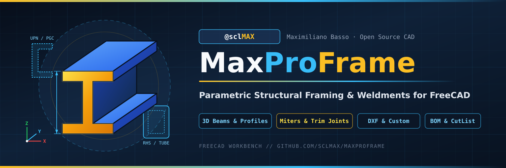
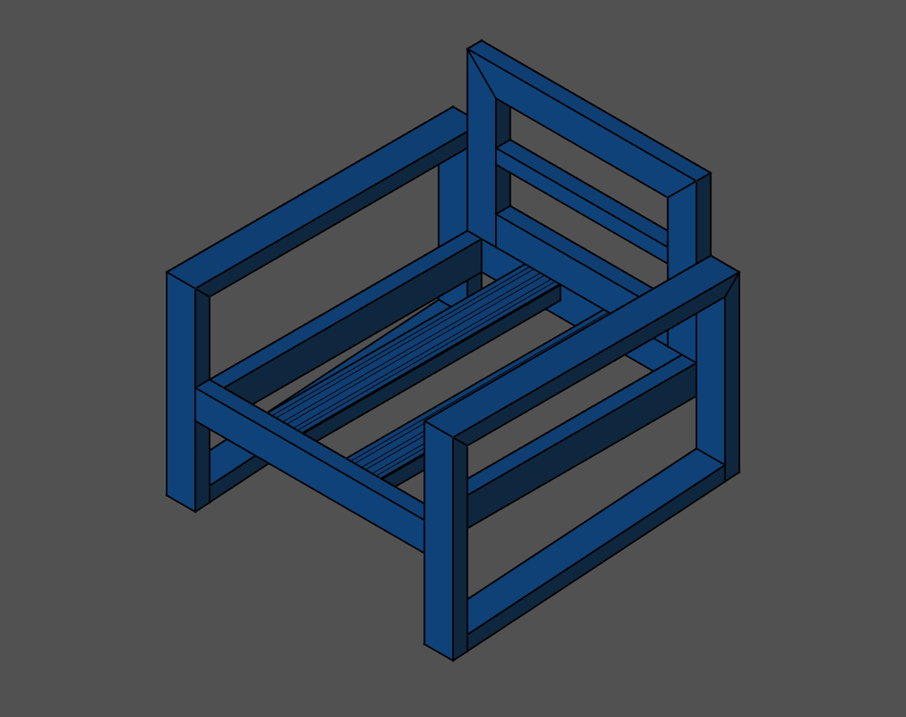
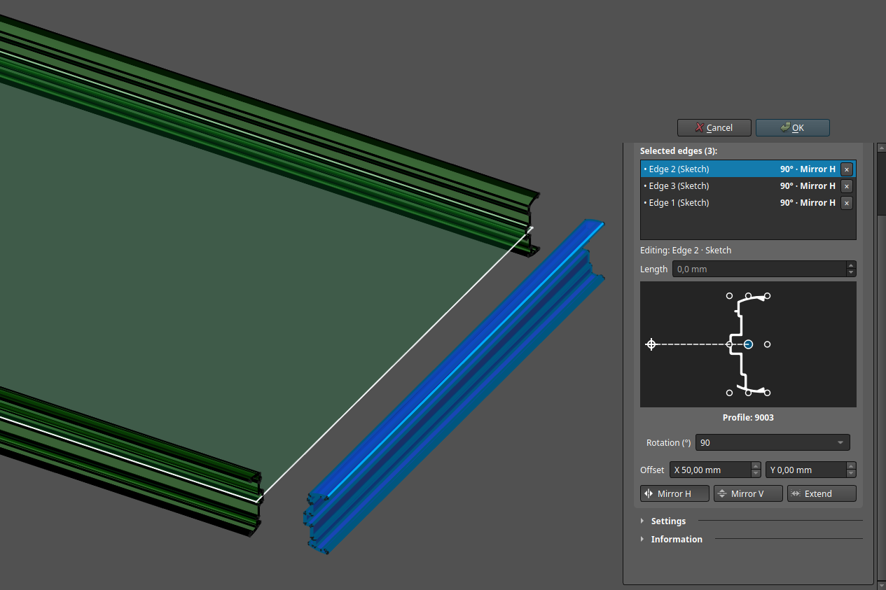
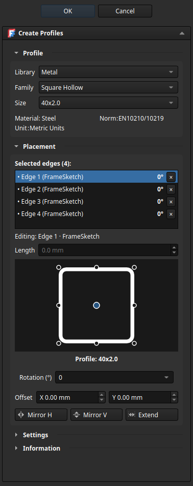
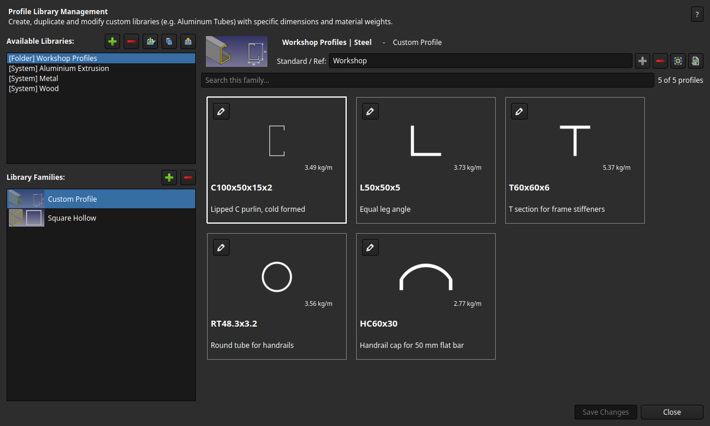
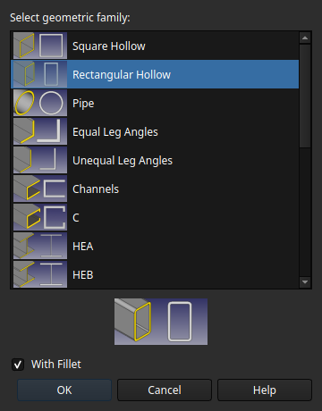
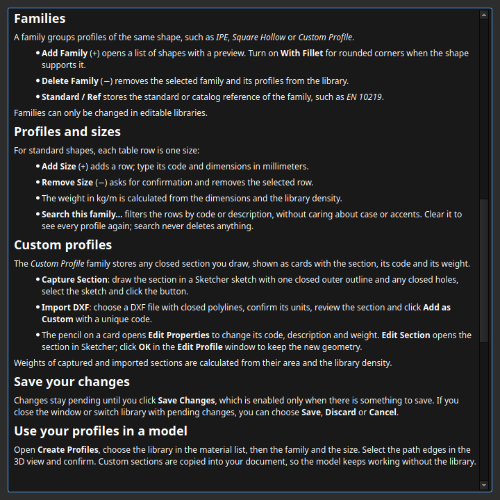
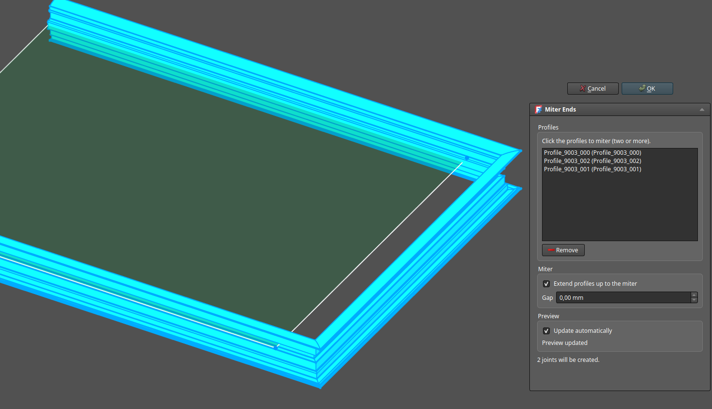
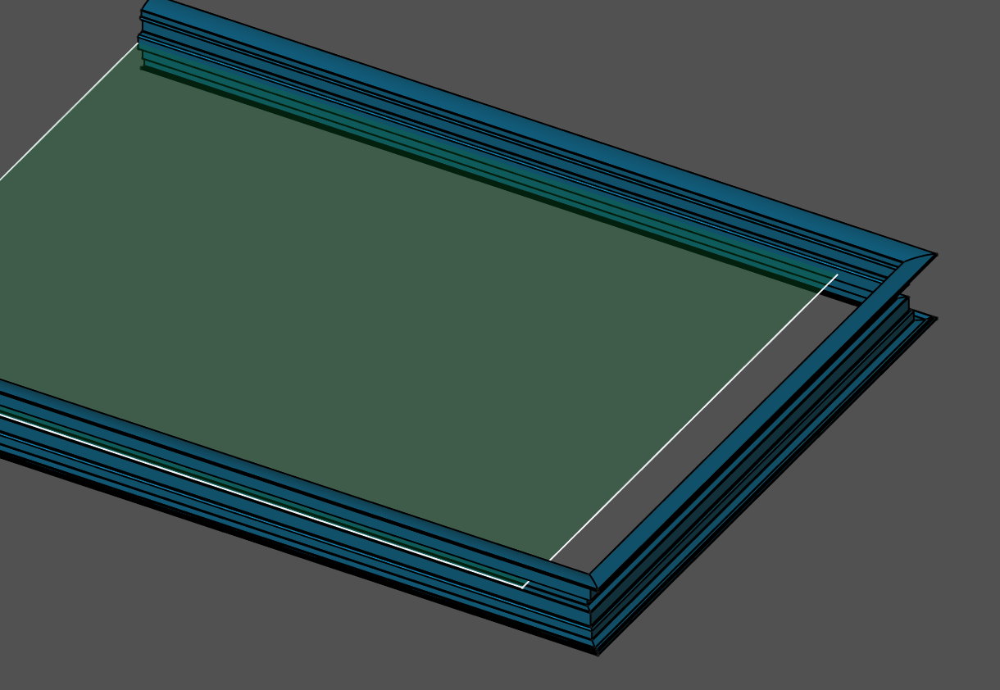

# MaxProFrame



[](https://github.com/sclMAX/MaxProFrame/actions/workflows/ci.yml)
[](https://github.com/sclMAX/MaxProFrame/releases)
[](https://www.freecad.org)
[](LICENSE)

**MaxProFrame** is a FreeCAD workbench for structural frames, weldments and profile work. Draw a skeleton with sketches or lines, place standard or custom profiles on its edges, miter and trim the joints, and get a cut list with real cutting angles.

It is made for metal workshops, makers and engineers who build frames in steel, aluminium extrusion or wood.

<p align="center"></p>

## Features

- **Profile catalogs**: HEA, HEB, HEM, IPE, IPN, UPN, UPE, channels, lipped C, angles, square, rectangular and round tubes, bars and flats, T-Slot and V-Slot aluminium extrusions, and wood sections.
- **Your own sections**: capture any closed Sketcher section or import a DXF into a portable folder library, with weight calculated from area and material density.
- **Profile Library Manager**: create, duplicate, share (ZIP or shared folder) and edit libraries, with section cards and a built-in English and Spanish guide.
- **Placement control**: nine alignment anchors, rotation, mirrors and X/Y offsets per edge, with a live preview of the section.
- **Joints**: end miters with live preview, extension and gap; **Notch** to fit profiles against the shape of another profile; **Extend / Cut** to bring several profiles up to a face; extruded cutouts for holes and clearances.
- **Fabrication output**: bill of materials and cut list with cutting angles, stock length and blade kerf; part IDs and TechDraw balloons.

## Screenshots

**Live placement preview**: edit the rotation, mirrors and offsets of each edge and see the profile move in the 3D view before you press OK.



| Create Profiles | Profile Library Manager |
|---|---|
|  |  |

| Add a family | Built-in help |
|---|---|
|  |  |

| Miter Ends with live preview | Mitered corners |
|---|---|
|  |  |

<!-- bom-cutlist.png, techdraw-balloons.png and workflow.gif are added when available -->

## Installation

MaxProFrame needs **FreeCAD 1.1.4 or newer**.

### With the Addon Manager (recommended)

Until MaxProFrame is listed in FreeCAD's Addon Index, add it as a custom repository once:

1. Open **Edit → Preferences → Addon Manager**.
2. Under **Custom repositories**, add the URL `https://github.com/sclMAX/MaxProFrame` with branch `release`.
3. Open **Tools → Addon Manager**, search for **MaxProFrame** and click **Install**.
4. Restart FreeCAD and select **MaxProFrame** in the workbench selector.

### Manual installation

Clone the `release` branch into your FreeCAD `Mod` folder and restart FreeCAD:

```bash
git clone --branch release https://github.com/sclMAX/MaxProFrame.git
```

The `Mod` folder is inside FreeCAD's user data folder, for example `~/.local/share/FreeCAD/v1-1/Mod` on Linux, `%APPDATA%\FreeCAD\v1-1\Mod` on Windows or `~/Library/Application Support/FreeCAD/v1-1/Mod` on macOS. Type `App.getUserAppDataDir()` in FreeCAD's Python console to see yours.

### Updating

The Addon Manager shows an update when a new version is published on the `release` branch. Each version is listed in the [releases](https://github.com/sclMAX/MaxProFrame/releases) and the [changelog](CHANGELOG.md). For a manual installation, run `git pull` in the `MaxProFrame` folder and restart FreeCAD.

## Quick start

1. **Draw the skeleton.** Switch to the **MaxProFrame** workbench, create a sketch and draw the frame lines. Each edge becomes one profile.
2. **Create profiles.** Click **Create Profiles**, choose the library, family and size, then select the sketch edges in the 3D view. The profiles are previewed as you change the settings; adjust the alignment, rotation or offset per edge and click **OK**.
3. **Miter the corners.** Click **End Miter** and click the profiles that meet (Ctrl+click removes one). Every corner they form is previewed; **Extend** closes short ends and **Gap** leaves room between the cut faces. Click **OK**.
4. **Fit the other joints.** Use **Notch** to fit several profiles against a target profile, copying its shape (for example an I beam ending on another I beam), and **Extend / Cut** to extend or cut several profiles up to a face, with an optional gap. Use **Extruded Cutout** for holes and clearances from a sketch.
5. **Get the cut list.** Click **Create BOM**, select the frame, choose grouping, stock length and kerf, and the cut list with lengths and angles is written to a spreadsheet.

The [tutorial](docs/tutorial.md) walks through a complete frame step by step, and the [profile task panel reference](docs/commands.md) explains alignment, offsets and per-edge settings.

## Profile libraries

Open **Manage Profile Libraries** to work with your catalogs. System libraries (Metal, Wood, Aluminium Extrusion) are read-only; duplicate one to change it. Folder libraries live in a folder you choose, together with their custom sections, so you can copy or sync them to another computer or exchange them as ZIP files.

To add your own section, select a **Custom Profile** family, then **Capture Section** from a closed sketch or **Import DXF**, and click **Save Changes**. Custom sections are copied into each document that uses them, so models keep working without the library.

Click **?** or press **F1** in the manager to open its guide at the section for what you are doing ([English](freecad/maxproframe/resources/help/library-manager.md), [Spanish](freecad/maxproframe/resources/help/library-manager.es.md)). More details: [folder libraries](docs/folder-libraries.md), [ZIP exchange](docs/library-zip.md), [DXF import](docs/dxf-section-import.md), [custom profiles](docs/custom-profiles.md).

## Coming from FrameForge

MaxProFrame started as a fork of [FrameForge](https://github.com/lukh/frameforge) and has since changed how profiles, joints and libraries work. Since version 1.0.0 it is an independent workbench:

- MaxProFrame and FrameForge can be installed side by side; neither replaces the other's modules, commands or settings.
- Documents created with FrameForge open with FrameForge. In MaxProFrame their profiles keep their shape but do not recompute.
- Personal libraries are read from `<FreeCAD user data>/MaxProFrame/profiles`. Move any libraries kept in `<FreeCAD user data>/FrameForge/profiles` to that folder.

## Languages

The workbench is available in English and Spanish and follows the language selected in **Edit → Preferences → General**.

## Compatibility and testing

Every change runs the full native test suite on the official FreeCAD 1.1.4 Linux AppImage and on a pinned FreeCAD weekly build. Every commit on `main` also runs it on the official FreeCAD 1.1.4 Windows build; that job is informative while the remaining Windows issues are fixed. macOS is expected to work but is not tested automatically yet. Please [report any problem](https://github.com/sclMAX/MaxProFrame/issues).

## Contributing

Bug reports and ideas are welcome in the [issue tracker](https://github.com/sclMAX/MaxProFrame/issues). To work on the code, see the [development setup](docs/development.md), [local FreeCAD testing](docs/local-freecad-testing.md) and [CI](docs/ci.md) guides.

## Support

If MaxProFrame helps your work, you can support its development:

- International: [Ko-fi](https://ko-fi.com/sclmax)
- Argentina: [Cafecito](https://cafecito.app/sclmax)

## Credits

Maintained by [sclMAX](https://github.com/sclMAX) (Maximiliano Basso).

MaxProFrame builds on **FrameForge**, originally written by Vivien Henry ([lukh/frameforge](https://github.com/lukh/frameforge)), and on **MetalWB**. Thanks to Vincent B, Quentin Plisson, rockn, Jonathan Wiedemann and the FreeCAD community.

## License

MaxProFrame is licensed under the [GNU Lesser General Public License v3.0](LICENSE).
